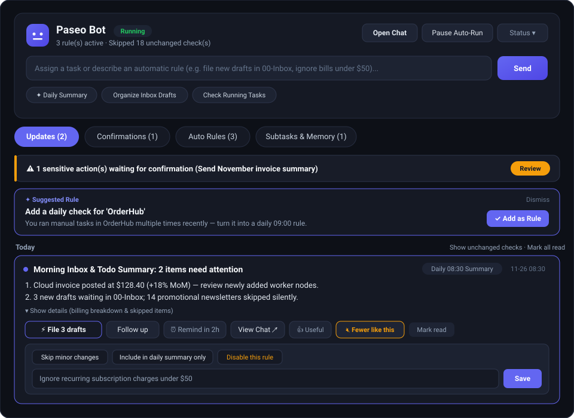
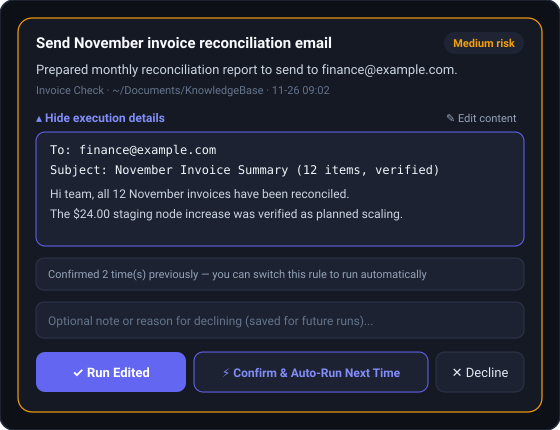
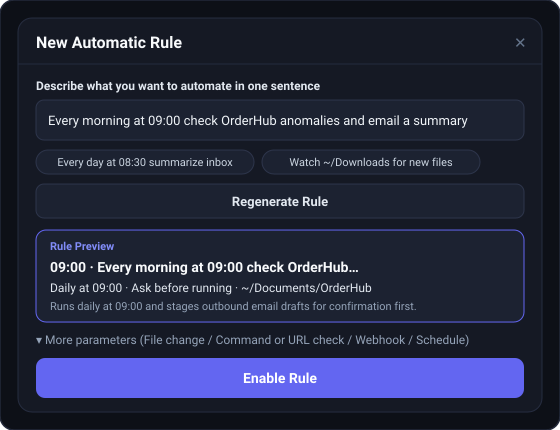
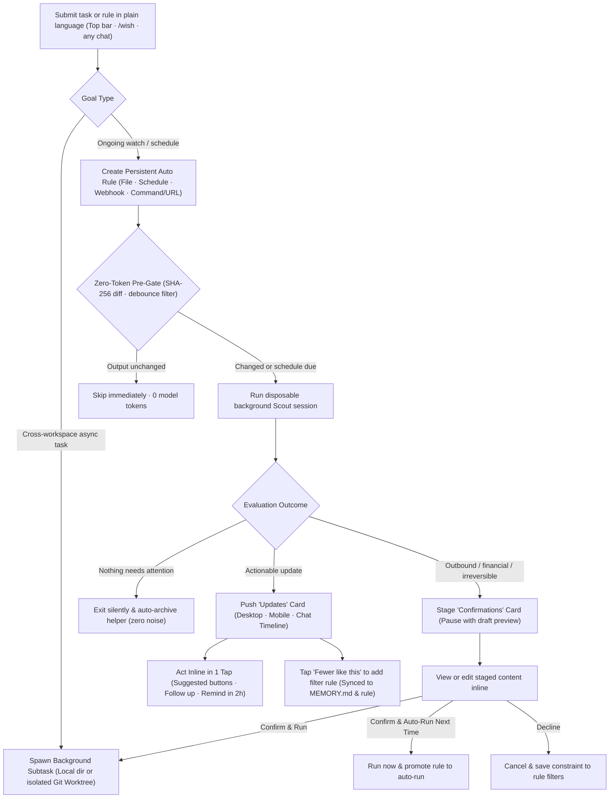

# Paseo Bot

English | [简体中文](README.zh-CN.md)

A proactive background automation plugin for [Paseo](https://paseo.sh) with plain-language rule creation, zero-token diff checks, actionable update cards, staged confirmations, persistent Markdown memory (`MEMORY.md`), and cross-workspace subtask delegation.

## UI & Interaction Mockups



| Staged Confirmation Card (Inspect, Edit & Enable Auto-Run) | One-Sentence Rule Builder (Plain Language to Preview) |
| --- | --- |
|  |  |

---

## Interaction Design & State Flow

### 1. End-to-End Interaction Loop



### 2. Three-Layer Information Density

| Layer | What Shows by Default | How to Expand / Inspect | Purpose |
| --- | --- | --- | --- |
| **Layer 1: Summary & Actions** | Single-line active/skipped summary in header; concise conclusions + action buttons on update cards | Visible immediately | Scan what matters in 3 seconds without quota clutter, webhook URLs, or log walls |
| **Layer 2: Details & Drafts** | Hourly run quota bar & webhook URL; supporting details on update cards; full draft/command preview on confirmation cards | Click `Status`, `Show details`, or `View execution details` (plus `Edit content` to tweak drafts inline) | Verify evidence or edit outbound text in place without leaving the screen |
| **Layer 3: Raw Agent Session** | Full Paseo agent tool-call trace, terminal output, and workspace diffs | Click `View Chat` on any card | Deep-dive into underlying agent execution only when needed |

### 3. Where to Find Everything in Paseo

| Surface | Entry / Trigger | Interaction Behavior |
| --- | --- | --- |
| **Sidebar Header Row** | `Paseo Bot` + trailing badge | Badge priority: **Pending confirmations (amber)** > **Unread updates (accent)** > **Running subtasks (muted)**; clicking while confirmations are pending opens the `Confirmations` tab directly |
| **Updates Feed** | `Updates` tab | Pins urgent pending confirmations and `Suggested Rule` cards (for workspaces with repeated manual tasks) at the top; groups cards into **Today** and **Earlier** |
| **Slash Command** | `/wish <task or rule>` | Submit a background task or automatic rule from any workspace composer |
| **Slash Command** | `/bot [inbox\|approvals\|missions\|workers]` | Open Paseo Bot or jump directly to a specific tab |
| **Agent Timeline Cards** | Inline update & confirmation cards | Same interactive controls right inside the chat stream: run 1-tap actions, snooze 2h, tune filters, or edit and confirm staged drafts |
| **Command Center & Settings** | `⌘K` / `Ctrl+K` → `Paseo Bot`, or `Settings → Paseo Bot` | Open Paseo Bot globally, pause/resume auto-run, configure default models, `MEMORY.md` path, and local webhook port |

---

## Features

- **Actionable Update Cards (No Log Walls)**
  - Unchanged routine checks exit silently in background scout sessions without cluttering your chat list.
  - Cards include expandable details, one-tap follow-up actions, inline follow-up replies, **Remind in 2h**, and **Useful / Fewer like this** filter controls (removable anytime when editing a rule).
- **Staged Confirmations & Progressive Auto-Run**
  - Outbound messages, financial actions, or irreversible changes pause in a confirmation card where you can view and edit the exact draft or instructions before running.
  - Confirm once, or choose **Confirm & Auto-Run Next Time** to promote trusted rules to run automatically.
- **One-Sentence Rule Builder & Five Trigger Engines**
  - Describe what to watch in plain language to auto-detect schedules, file watchers, webhooks, or zero-token command/URL diff checks (advanced parameters stay tucked away until needed).
  - Built-in engines: recursive file watching (with self-write loop protection), `127.0.0.1` HTTP webhooks, SHA-256 zero-token command/URL polling, daily/interval schedules, and agent-scheduled `self_wake` reminders.
- **Cross-Workspace Subtasks & Obsidian-Friendly Memory**
  - Delegate background subtasks to local directories or isolated Git worktrees and collect completion summaries automatically.
  - Syncs preferences, active goals, and filter rules directly with a plain Markdown `MEMORY.md` file.

## Install

Requires Paseo `>= 0.17.4` with plugins enabled:

```bash
paseo plugin install github:shinelinxx/paseo-bot
```

## Development

```bash
npm install
npm run typecheck
npm test
paseo plugin install /absolute/path/to/paseo-bot
paseo plugin reload paseo-bot
```

## License

MIT
