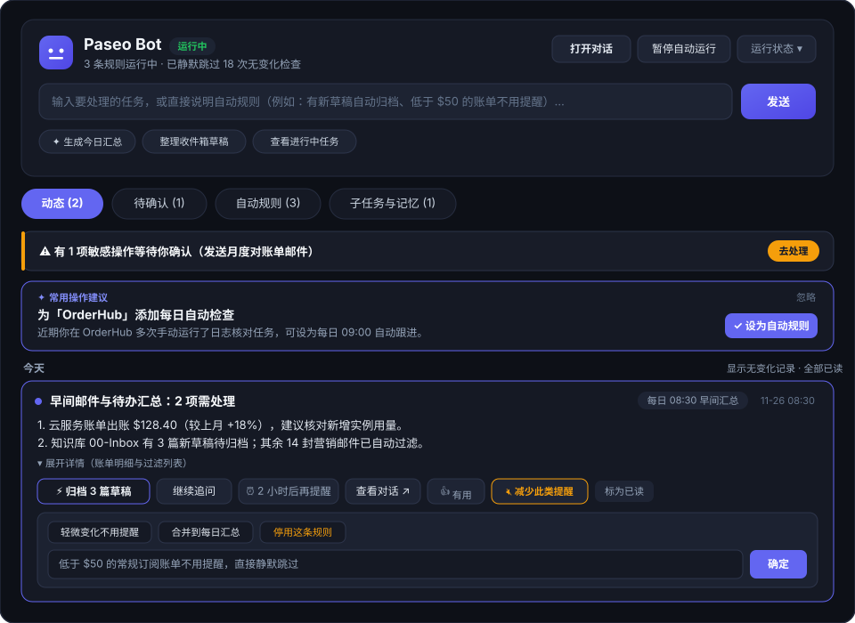
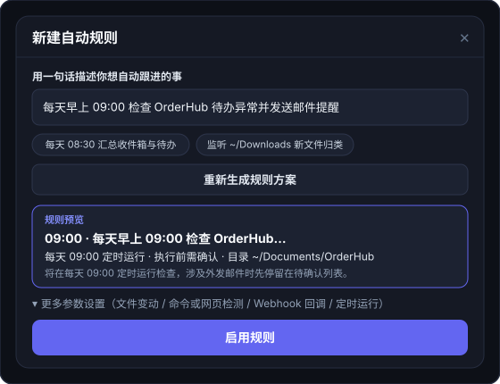
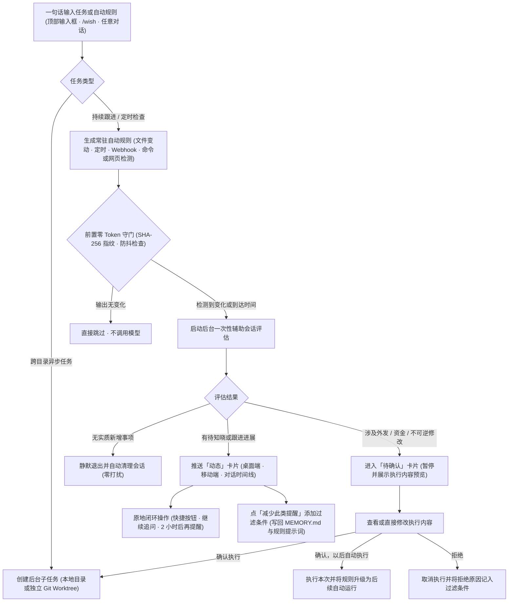

# Paseo Bot（简体中文）

[English](README.md) | 简体中文

面向 [Paseo](https://paseo.sh) 的后台自动任务与主动提醒插件：支持一句话创建自动规则、无变化静默跳过、带快捷按钮的动态卡片、敏感操作内容预览与确认、Obsidian 友好的长期记忆同步（`MEMORY.md`），以及跨目录子任务协同。

## 界面交互稿预览



| 待确认卡片（查看/修改内容 · 升级自动执行） | 新建自动规则（一句话生成规则预览） |
| --- | --- |
|  |  |

---

## 交互设计与状态流转

### 1. 核心闭环流程



### 2. 三层信息密度（渐进展开，避免日志刷屏）

| 层级 | 默认呈现内容 | 展开 / 跳转方式 | 设计目的 |
| --- | --- | --- | --- |
| **第 1 层：概览与结论** | 顶部状态栏仅展示运行规则数与已跳过次数；动态卡只展示简短结论与操作按钮 | 默认可见 | 打开面板 3 秒内看清重点，不被配额数字、Webhook 地址或长篇日志干扰 |
| **第 2 层：依据与编辑** | 每小时触发配额进度与本地 Webhook 地址；动态卡的详细判断依据；待确认卡的草稿/指令正文 | 点击 `运行状态`、`展开详情` 或 `查看执行内容`（支持点 `修改内容` 原地改草稿） | 需要核对细节或微调文案时原地展开，无需频繁切换页面 |
| **第 3 层：原始会话** | 底层 Paseo Agent 的完整工具调用轨迹、终端输出与代码改动 | 点击卡片上的 `查看对话` | 需要排查底层执行细节时一键直达原始会话 |

### 3. Paseo 内各交互触点速览

| 位置 | 入口 / 触发方式 | 交互行为说明 |
| --- | --- | --- |
| **侧边栏顶部入口** | `Paseo Bot` 行 + 右侧状态角标 | 角标按优先级显示：**待确认数（橙色）** > **未读动态数（主题色）** > **运行中子任务数（灰色）**；存在待确认项时点击直接定位到「待确认」标签页 |
| **主面板动态页** | `动态` 标签页 | 顶部自动置顶待确认横幅（免切页）与高频目录的「常用操作建议」卡片；消息按 **今天 / 更早** 分组 |
| **斜杠指令** | `/wish <目标或规则>` | 在任意工作区输入框直接提交后台任务或自动规则 |
| **斜杠指令** | `/bot [inbox\|approvals\|missions\|workers]` | 快速打开面板或直达指定标签页 |
| **对话时间线卡片** | 主对话内嵌动态卡 / 待确认卡 | 与面板共享同一套交互：支持在聊天流里直接点按钮执行动作、设置 2 小时后再提醒、减少此类提醒或修改内容后确认执行 |
| **命令面板与设置** | `⌘K` / `Ctrl+K` → `Paseo Bot`，或 `设置 → Paseo Bot 设置` | 全局打开面板、暂停/恢复自动运行、配置默认模型、记忆文件路径与本地 Webhook 端口 |

---

## 核心特性

- **可直接处理的动态卡片**
  - 例行检查在后台一次性辅助会话中执行，无新增变化时自动静默跳过，不留多余会话。
  - 卡片内支持一键执行后续操作、原地继续追问、**2 小时后再提醒**，以及通过 **有用 / 减少此类提醒** 直接添加过滤条件（可在编辑规则时随时移除）。
- **敏感操作内容预览与自动执行升级**
  - 涉及外发消息、资金或不可逆修改的操作先停在「待确认」列表，支持展开查看并直接修改待执行内容。
  - 支持 **确认执行** 或 **确认，以后自动执行**，对验证稳妥的规则可一键转为后续自动运行。
- **一句话生成规则 + 五类后台触发源**
  - 输入一句自然语言即可自动识别触发方式、工作目录与确认方式（更多参数默认折叠，按需展开）。
  - 内置五类触发源：目录/文件变动监听（含自身写入防循环）、本机 `127.0.0.1` Webhook 接收、SHA-256 零 Token 命令/网页差量检测、每日定点/间隔运行，以及单次延时提醒。
- **跨目录子任务与 Markdown 长期记忆**
  - 支持将后台任务分发到指定项目目录或独立 Git Worktree，完成后自动汇总结果。
  - 长期偏好、关注目标与过滤条件直接读写本地 `MEMORY.md`，可与 Obsidian 笔记双向同步。

## 安装

需要 Paseo `>= 0.17.4` 且已开启插件功能：

```bash
paseo plugin install github:shinelinxx/paseo-bot
```

## 本地开发

```bash
npm install
npm run typecheck
npm test
paseo plugin install /absolute/path/to/paseo-bot
paseo plugin reload paseo-bot
```

## 许可证

MIT
