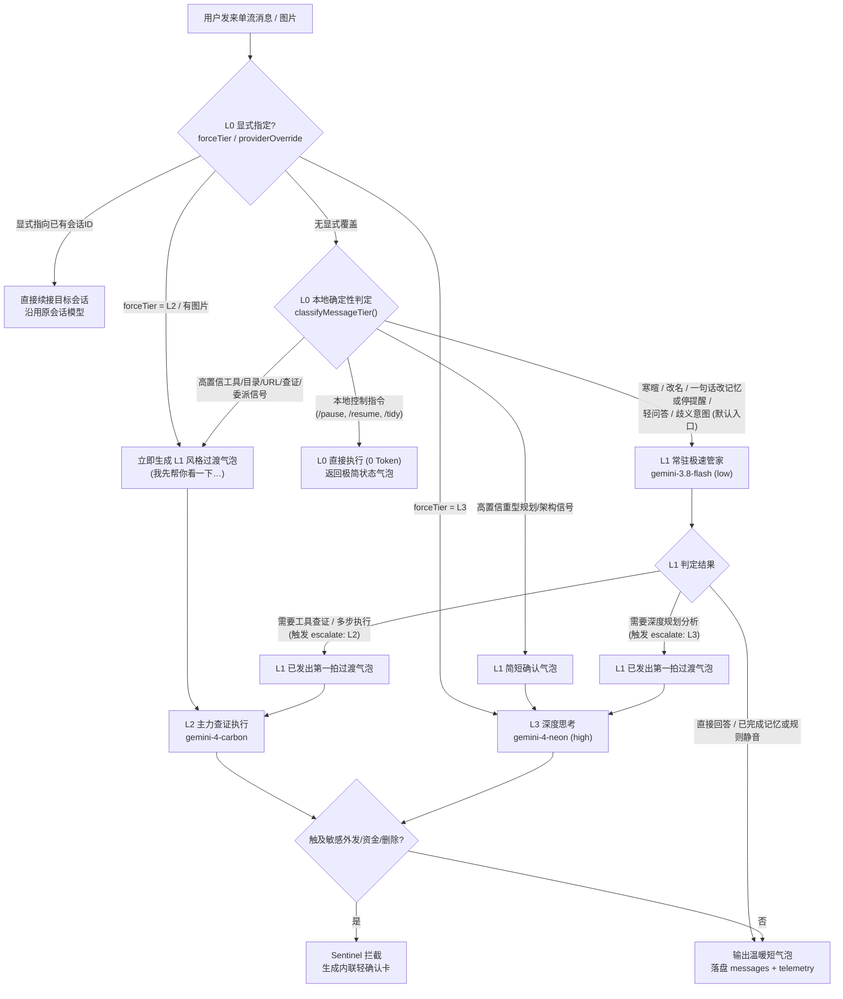

# L0–L3 多层模型分流规格（Tiered Routing Spec · v0.4.0）

> **工单溯源**：`T-001`（M1 · 体验协议与分层架构）  
> **维护责任**：管家总舵（`butler-lead`）  
> **核心依据**：`AGENTS.md`（L0–L3 铁律）、`.company/decisions.md`（ADR-002）、Paseo 实测模型列表  
> **下游消费方**：`routing-engine`（T-002）、`persona-tuner`（T-001 提示词）、`bubble-ui`（T-003 状态展示）、`qa-gatekeeper`（门禁校验）

---

## 1. 分流总原则：拒绝一上来就上重模型

v0.3.0 中 `shared/settings.ts` 将 `chiefProvider`、`scoutProvider`、`defaultWorkerProvider` 全部默认设为 `antigravity/gemini-4-neon`，导致每一次寒暄、轻问答、记忆确认、例行巡检都在冷启动重推理模型——既慢又耗额度，破坏“随口聊一句”的私人管家体感。

v0.4.0 建立严格的 **L0 → L1 → L2 → L3 四层漏斗**：

| 层级 | 名称 | 默认模型与推理档位 | 延迟目标 | 核心职责 | 严禁事项 |
|---|---|---|---|---|---|
| **L0** | 零 Token 门禁与确定性路由层 | 无模型（本地代码规则 / SHA-256） | `< 10ms` | 1) 后台差量指纹（`poll_command` SHA-256）、`fs.watch` 防抖与 stat 签名、自写防循环、Webhook 密钥与正则、冷却与每小时唤醒熔断；2) 交互层预分流（显式覆盖、直接会话引用、纯控制指令、意图信号粗分） | 严禁对未变化的后台轮询唤醒任何模型 |
| **L1** | 极速轻量前台层 | 默认 `antigravity/gemini-3.8-flash`（`thinking: "low"`）<br>备选 `antigravity/gemini-4-hydrogen`（`thinking: "low"`） | 首响 `1–3s` | 1) 日常秒回寒暄、称呼/改名、闲聊与简单知识问答；2) **一句话更新记忆（`MEMORY.md`）与静默停用/过滤旧提醒**；3) 语义意图复判：能答直接答，需查工具/代码/外部系统时先回一句自然过渡气泡并无缝交棒 L2；4) 后台轻量事件初筛 | 严禁在 L1 层跑多步代码改动、重型外部排查或绕过 Sentinel |
| **L2** | 主力执行与查证层 | 默认 `antigravity/gemini-4-carbon`（`thinking: "medium"` / 委派任务 `"high"`） | 按任务复杂度 | 1) MCP / 工具核查（邮箱、Cloudflare、文件系统、工作区状态等）；2) 跨工作区委派子任务（`delegateTask`）、创建/管理复杂规则；3) 后台常规主动巡检（`scoutProvider` 默认降至 L2，不再默认 L3）；4) 带图片的多模态查证与处理 | 简单寒暄和一句话改记忆不得落入 L2 |
| **L3** | 重型深思升舱层 | 默认 `antigravity/gemini-4-neon`（`thinking: "high"`） | 按需升舱 | 仅在以下情况触发：1) 用户在输入栏显式开启「深度思考 · L3」或显式要求深度规划/架构设计/长文深析；2) L2 遇到复杂多仓/系统架构决策主动升舱；3) 显式选择 L3 模型覆盖 | 严禁作为默认首响模型 |

---

## 2. 设置项与模型默认梯度（`shared/settings.ts`）

### 2.1 新增分层模型配置（严格向后兼容旧设置）

在 `BotSettingsSchema` 中新增带默认值的分层字段（旧用户 `settings` JSON 缺失新字段时由 Zod `.default()` 自动补齐，零破坏）：

```ts
// 管家拟人身份
butlerName: z.string().default("Paseo Bot"),
userName: z.string().default(""),

// L1–L3 分层模型配置（核心改造）
fastProvider: z.string().default("antigravity/gemini-3.8-flash"),
fastFallbackProvider: z.string().default("antigravity/gemini-4-hydrogen"),
fastThinking: z.string().default("low"),

execProvider: z.string().default("antigravity/gemini-4-carbon"),
execThinking: z.string().default("medium"),

deepProvider: z.string().default("antigravity/gemini-4-neon"),
deepThinking: z.string().default("high"),

// 旧字段保留兼容，默认值降噪对齐新梯度
chiefProvider: z.string().default("antigravity/gemini-4-carbon"),      // 旧值 neon → 对齐 L2
scoutProvider: z.string().default("antigravity/gemini-4-carbon"),      // 旧值 neon → 对齐 L2
defaultWorkerProvider: z.string().default("antigravity/gemini-4-carbon"), // 旧值 neon → 对齐 L2
```

> **兼容约束**：若用户曾在旧版设置里手动保存过自定义 `chiefProvider` / `scoutProvider`，`BotSettingsSchema` 仍正常读取不丢失；分层引擎优先使用 `fastProvider`（L1）、`execProvider`（L2）、`deepProvider`（L3），在 `BotSettingsScreen.tsx` 中以清晰的「L1 极速秒回 / L2 主力查证 / L3 深度思考」三档选择器呈现。

---

## 3. 路由决策状态机（Deterministic L0 + Smart L1 Handoff）

### 3.1 完整路由流程图



### 3.2 L0 本地确定性分类规则（纯函数，必须 100% 单测覆盖）

在 `server/router.ts` 中实现纯函数 `classifyMessageTier(input)`：

```ts
export interface RoutingDecision {
  tier: "L0" | "L1" | "L2" | "L3";
  reason:
    | "explicit_override"
    | "direct_session_route"
    | "local_control_command"
    | "image_attachment"
    | "memory_or_mute_reply"
    | "casual_chat_or_qa"
    | "tool_or_workspace_action"
    | "deep_analysis_request";
  immediateAckText?: string; // 若直达 L2/L3，可选秒出第一拍自然过渡气泡
  localCommand?: "pause" | "resume" | "tidy_preview";
  matchedTriggerId?: string; // 紧跟主动提醒回复"停用/不用提醒"时携带关联 triggerId
}
```

**确定性匹配优先级（自上而下，命中即停）**：

1. **显式覆盖（`explicit_override`）**：
   - `input.forceTier` 存在 → 直接按指定档位（`L1` / `L2` / `L3`）；
   - `input.providerOverride` 存在 → 若匹配 `deepProvider` 则记 `L3`，匹配 `fastProvider` 则记 `L1`，否则 `L2`。
2. **纯本地控制指令（`L0 · local_control_command`，0 Token）**：
   - 精确匹配 `/pause`、`"暂停全部后台规则"` → 调用 `setGlobalPaused(true)` 并回短气泡；
   - 精确匹配 `/resume`、`"恢复后台规则"` → 调用 `setGlobalPaused(false)` 并回短气泡；
   - 精确匹配 `/tidy` → 调用 `tidySessions({ mode: "preview" })`，若生成审批则自动落入内联确认卡。
3. **已有会话显式续接（`direct_session_route`）**：
   - 命中 `hasDirectSessionReferenceHint(text)` 且 `routeDirectWishToSession` 命中活跃会话 → 沿用原会话模型续接，在单流气泡中给出一条清晰过渡提示（附 `paseo://agent/<id>` 链接）。
4. **图片附件（`L2 · image_attachment`）**：
   - `images.length > 0` → 至少路由到 **L2**（若同时命中深度分析关键词则升舱 L3），因为识图与核对需强多模态能力。
5. **一句话改记忆 / 停提醒 / 改称呼（`L1 · memory_or_mute_reply`）**：
   - 命中以下信号且不含显式深度排查请求，优先送 **L1**（并附上最近一条主动提醒的 `triggerId`/`triggerName` 上下文）：
     - 停用/更换/忽略信号：`(停用了|不用提醒|别再提醒|不再提醒|换[成成了]|改用|以后按|记住|帮我记一下|忽略.*提醒|静音)`
     - 改称呼信号：`(叫你|给你取名|以后叫我|称呼我)`
6. **深度复杂分析与架构规划（`L3 · deep_analysis_request`）**：
   - 命中以下高复杂度信号（且消息较长或明确要求深思）：
     - 显式深思词：`(深度分析|详细规划|架构设计|重构方案|全面审计|对比评估多个方案|写一份完整.*报告|deep dive|architecture design|rfc)`
     - 或正文长度 `>= 600` 字符且包含多步分析/对比诉求。
7. **工具核查 / 执行动作 / 跨工作区派活（`L2 · tool_or_workspace_action`）**：
   - 命中以下动作/查证信号：
     - 显式路径、URL、命令反引号：`(~/|/Users/|https?://|\`[^\`]{3,}\`)`
     - 外部工具与核查动词：`(查一下|帮我查|核实|检查.*邮箱|看下.*邮件|cloudflare|tunnel|ssh|服务器|部署|更新.*代码|修复.*bug|运行测试|整理收件箱|00-inbox|创建.*定时|每天.*点|监听.*目录|webhook|子任务|工作区进度|github|pr|commit)`
     - 命中已知工作区名或 `MEMORY.md` 工作区映射关键词且带执行意图。
8. **默认兜底（`L1 · casual_chat_or_qa`）**：
   - 其余所有寒暄、短问句、随口聊天、概念问答、歧义短句 → **一律先走 L1**！宁可由 L1 秒回后再按需交棒 L2，也绝不一上来冷启动重模型。

---

## 4. L1 常驻极速会话与 L1→L2/L3 无缝交棒机制

### 4.1 L1 常驻管家会话（Warm Concierge Agent）

- **生命周期**：
  - 首次进入 L1 时，通过 `workspace.agents.create` 在 `homeCwd` 创建（或复用持久化的 `state.l1AgentId`）一个 `background: true` 的 L1 会话，标签 `labels: { "paseo-bot/role": "butler-l1" }`。
  - 模型：`resolveTierLaunchConfig("L1")`（默认 `antigravity/gemini-3.8-flash`，`thinkingOptionId: "low"`，权限模式使用轻量兼容模式）。
  - 系统提示词：加载 `prompts/butler-persona.md` + `prompts/l1-router-prompt.md` 核心约束 + 当前 `MEMORY.md` 摘要 + 当前管家名/用户称呼。
- **L1 工具白名单（最小权限，保速度与安全）**：
  - `paseo_bot_memory_read`
  - `paseo_bot_memory_write`
  - `paseo_bot_list_triggers`
  - `paseo_bot_update_trigger`（用于一句话静默暂停旧提醒）
  - `paseo_bot_self_wake`（用于一句话设置“2小时后提醒我”）
  - **新增 `paseo_bot_escalate_task`（交棒工具）**：当 L1 判断需要查外部系统、读代码、操作工作区或深度规划时，调用此工具声明 `{ targetTier: "L2" | "L3", ackBubble: string, handoffBrief: string, cwd?: string }`。
  - **严禁给 L1 挂载**：重型 `delegate_task` 或高危直接执行能力；一切外发/资金/删除仍必须经 L2/L3 + `paseo_bot_request_approval`（Sentinel）。
- **一句话改记忆 + 静默旧提醒闭环（复刻 Dot 参考图 2）**：
  - 发送给 L1 的上下文自动附带「最近 3 条对话气泡（含最新主动提醒的 `triggerId` / `triggerName`）」。
  - 当用户说 `"停用了，我换 example.net 了"` 时：
    1. L1 调用 `paseo_bot_memory_write` 记录「legacy-api.io 已主动停用，当前使用 example.net，不再提醒旧域名」；
    2. 若关联了 `triggerId`，L1 调用 `paseo_bot_update_trigger`（停用或追加过滤词）；若关联的是本地 `noiseRules`，引擎支持同步更新过滤条件；
    3. L1 返回一句温和短气泡：`"明白，legacy-api.io 是主动停用的，不用赎回。以后按 example.net 来，旧域名就不再提醒了。"`

### 4.2 L1 → L2 / L3 两拍交棒协议（Two-Beat Handoff）

无论是由 **L0 直接判定进入 L2/L3**，还是由 **L1 通过 `paseo_bot_escalate_task` 主动升舱**：

1. **第一拍（即时过渡气泡，`kind: "ack"`）**：
   - 在 `< 500ms`（L0 直达）或 `< 2.5s`（L1 交棒）内向 `messages` 写入一条 `role: "assistant", kind: "ack", status: "thinking"` 短气泡，例如：
     - L1 交棒：使用 L1 生成的贴合上下文的 `ackBubble`（如 `"我先查这 4 条 Tunnel 对应的主机、安装方式，以及我有没有现成的登录权限。"`）；
     - L0 直达 L2/L3：生成自然克制的短句（如 `"我先帮你查一下，稍等片刻。"` / `"我先打开深度思考仔细梳一下，好了发你。"`），绝不出现机器人式的 `"正在启动 Worker Agent..."`。
   - 立即 `broadcastSnapshot()`，前端气泡流立刻出现过渡消息 + 柔和思考态，用户感知零等待。
2. **第二拍（L2/L3 核查执行与结果回流，`kind: "chat"`）**：
   - 后台按目标层级（`L2` 或 `L3`）启动/复用执行 Agent（加载 `prompts/butler-persona.md` 风格要求 + 诚实汇报能力边界要求 + Sentinel 铁律）。
   - 执行完毕后（通过 `agent.turn.after` 或直接 `waitForFinish` 回调）：
     - 将第一拍 `ack` 气泡的 `status` 从 `"thinking"` 更新为 `"done"`（保留过渡气泡，还原参考图 2 的两段自然对话感！）；
     - 追加第二拍 `role: "assistant", kind: "chat", tier: "L2" | "L3", replyToMessageId: ackId` 的核实结论气泡（带加粗重点、内联链接与清晰边界说明）；
     - 若执行途中触发了 `paseo_bot_request_approval`，自动在单流中插入 `kind: "approval"` 内联轻确认卡，等待用户拍板。

### 4.3 后台主动巡检与事件触发分层（Proactive Funnel）

- **Stage L0（0 Token）**：`poll_command` SHA-256 指纹未变化 / `file_watch` 忽略路径或 stat 未变化 / Webhook 正则不匹配 / 冷却期内 / 每小时唤醒上限 → **直接静默跳过，记录 `routingTelemetry.l0Hits++`**。
- **Stage L1→L2（后台巡检降本）**：
  - 原生计划与事件规则默认使用 `scoutProvider`（默认从 `gemini-4-neon` 降至 `L2: antigravity/gemini-4-carbon`）；
  - 对纯轻提醒类 `self_wake`（无代码/多步工具需求），优先使用 `L1` 执行；
  - 巡检提示词注入 `prompts/proactive-bubble-style.md` 规范：无实质变化调用 `paseo_bot_report_outcome(level: "silent")` 零打扰；有变化时输出**直呼用户名字、结论先行、带内联可点链接的温暖短气泡**，自动同步写入单流 `messages`（`kind: "proactive"`）。

---

## 5. 超时、降级与容错矩阵（Resilience & Fallback）

| 故障场景 | 降级策略 | 用户可见体验 |
|---|---|---|
| **L1 首选模型（`gemini-3.8-flash`）不在可用列表或报错** | 自动降级顺序：`fastFallbackProvider`（`gemini-4-hydrogen`）→ `execProvider`（`gemini-4-carbon`）→ 目录首个可用模型；`routingTelemetry.fallbackCount++` | 无感降级，正常返回短气泡 |
| **L1 响应超时（> 18s）** | 中止本次 L1 等待，标记旧 `l1AgentId` 重置，无缝改由 L2 承接并回复 | 仅轻微变慢，绝不卡死在 `"thinking"` |
| **L2 模型不可用** | 降级至 `deepProvider` → `fastFallbackProvider` → 目录首个可用模型 | 无感降级 |
| **L3 模型不可用** | 降级至 `execProvider`（`thinking: "high"`）→ 目录首个可用模型 | 无感降级 |
| **`l1AgentId` 已被用户归档或关闭** | 捕获 `refresh()` 异常或 `archivedAt`，静默清空 `state.l1AgentId` 并自动重建新 L1 会话 | 透明自愈，不弹红框错误 |
| **Invalid modeId 错误** | 复用现有 `createAgentWithModeFallback` 与 `pickCompatibleModeId` 机制 | 零回归 |
| **执行过程彻底异常（断网/Provider 宕机）** | 将 `thinking` 态气泡转为 `status: "error"`，输出温和坦诚说明（`"刚才查询时出了点小状况（原因…），你稍后可以再让我试一次。"`） | 不白屏、不卡死、不留僵尸加载态 |

---

## 6. 不可妥协的工程与安全红线（供 T-002 与 QA 逐条核验）

1. **Sentinel 零绕过**：无论 L1、L2 还是 L3，任何外发邮件/消息、资金交易、破坏性删除、不可逆操作都必须调用 `paseo_bot_request_approval` 生成待确认卡，绝不因分层提速而放宽权限。
2. **原生定时计划单源同步**：`~/.paseo/schedules` 读写、监听与 CLI 同步逻辑保持唯一真相源，绝不另起定时系统。
3. **`state.json` 100% 向后兼容**：旧版无 `messages` / `l1AgentId` / `routingTelemetry` 的 `state.json` 加载、读写与重启零异常。
4. **可观测与可测**：`server/router.ts` 的 L0 分类函数、降级链选择函数、旧 `feed`→`messages` 迁移函数、一句话静音/记忆更新逻辑均须作为纯函数导出，并在 `tests/` 中补齐覆盖全部 4 层的自动化单测。
5. **模型可见性**：前端主对话流保持干净不堆砌模型徽章，但抽屉「分流与状态」及每条 `ChatMessage` 元数据清晰记录 `tier`、`modelUsed`、`latencyMs`，便于老板随时抽查确认“绝非一上来就上重模型”。
